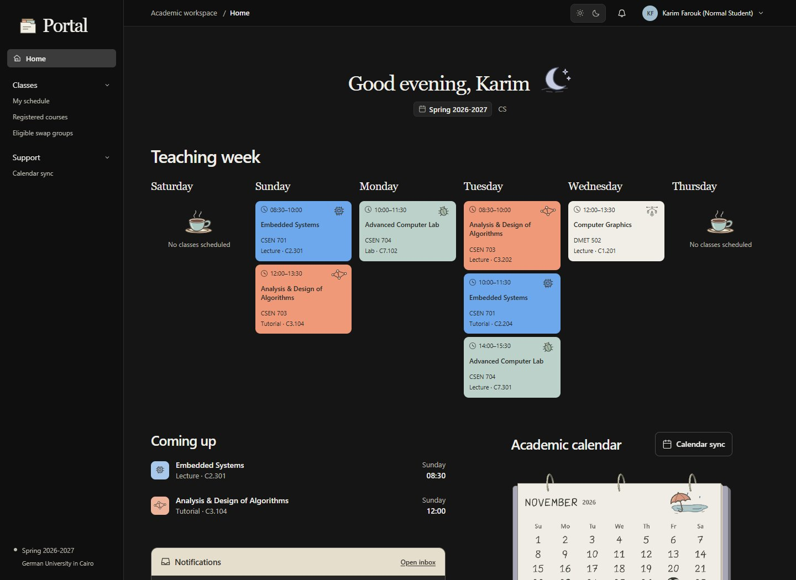
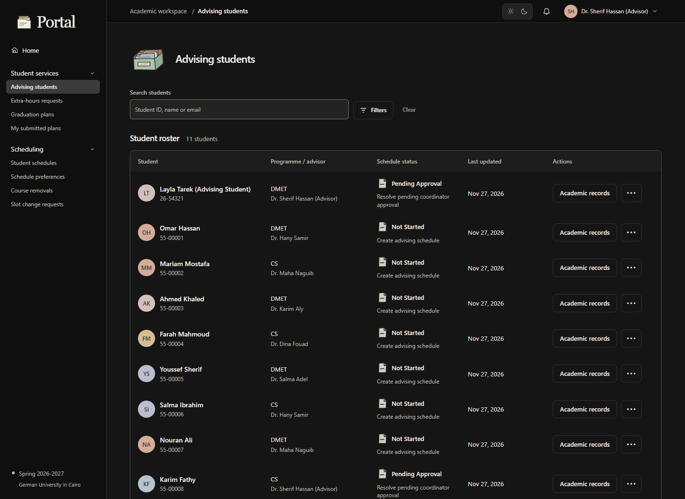
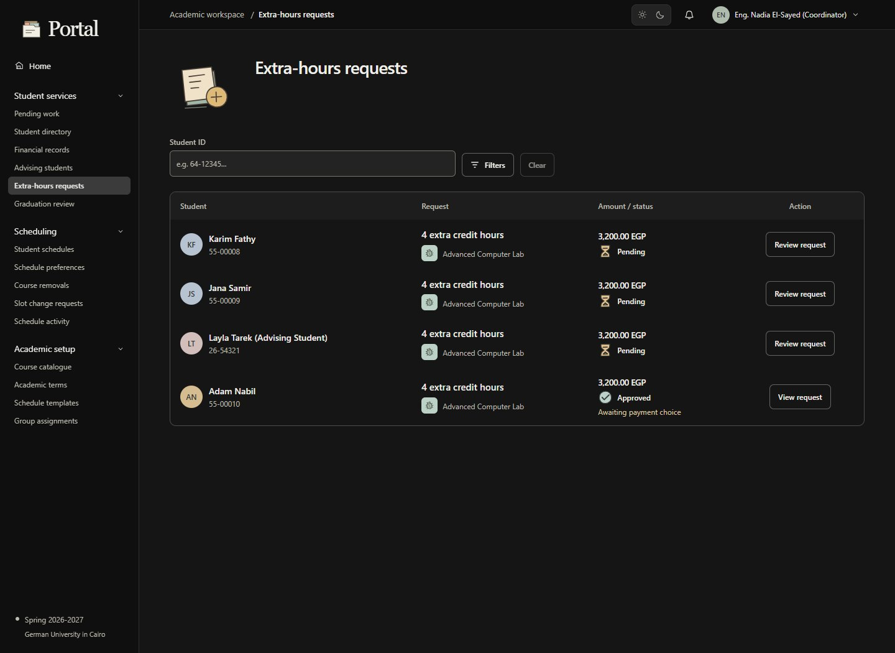
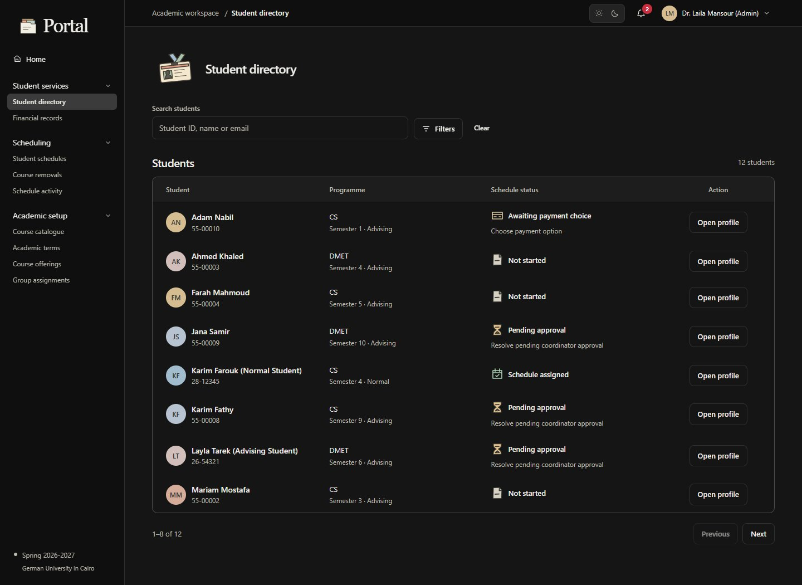
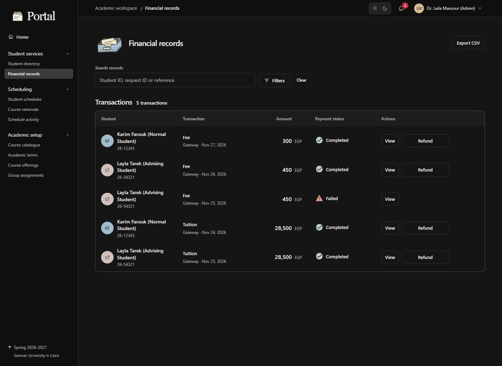
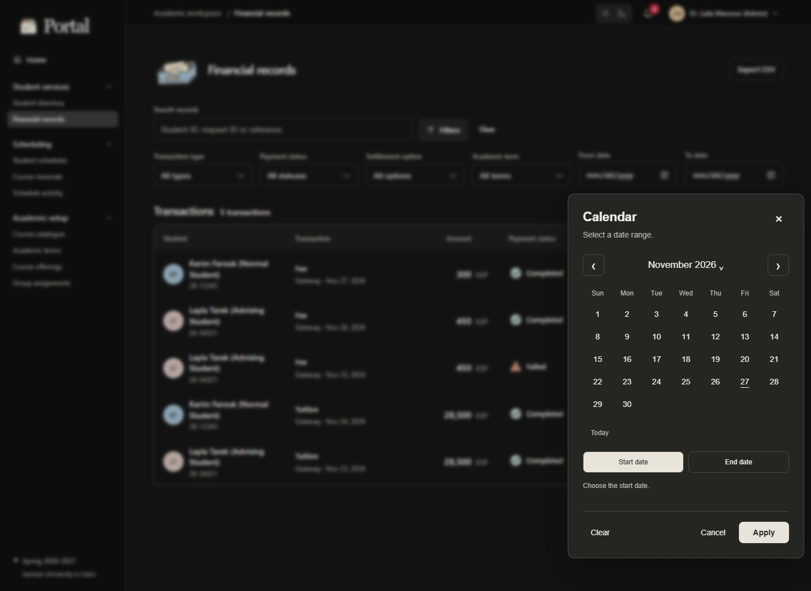

# Bobos | University Schedule Management System

Bobos is a web portal for academic scheduling and advising at the German University in Cairo. Normal students, advising students, advisors, coordinators, and administrators each sign in to a workspace with the actions and records their role can access. The team built it for CSEN704 Sprint 2.

## Motivation

A timetable change can affect more than a student's week. It can consume a seat, conflict with a tutorial, or require approval before it becomes official. Bobos keeps those decisions with the schedule they affect. Students can see what is ready, what is awaiting a decision, and what they need to do next. Staff can follow the same request across advising, academic records, and payments.

## Build status

GitHub Actions runs the functional and browser suites on pushes and pull requests targeting `development` or `main`. On the local Sprint 2 baseline `2997234`, the production build succeeded and all 21 browser tests passed. Of 358 functional checks, 357 passed. The Requirement 121 startup-reminder test hit its five-second startup deadline in that run and passed on an isolated rerun. The [GitHub Actions run for this commit](https://github.com/Advanced-Computer-Lab-2026/Bobos/actions/runs/46045616414) passed.

| Known issue or limit | Effect |
| --- | --- |
| Requirement 121 startup test can time out | A slow API startup can fail the reminder test before it reaches the notification assertions. |
| Checkout supports Stripe sandbox only | Card payments use test transactions in EGP. Checkout needs an `sk_test_` key and accepts one settlement method per request. |
| SMTP and Google Calendar need separate configuration | Email password reset, probation emails and Calendar sync need provider credentials. Automated tests use local mail and controlled provider responses. Live provider availability needs a separate check. |
| Optional advisor and administrator seeds require prepared fixtures | The advisor preview seed expects a published Scientific Methods offering and a future term. The administrator preview seed looks up student IDs that differ from those created by Quick demo sign-in. The installation steps use the base and timetable seeds. |
| Assessment deployment needs its own accounts and data | Local seed fixtures are for development. The hosted portal needs provisioned university accounts and a smoke test of each role. See [production readiness](docs/production-readiness.md). |

## Code style

- Use JavaScript ES modules (`import` and `export`). React components and Mongoose model names use `PascalCase`, as in `FinancialRecordsPage` and `StudentSchedule`. Functions and variables use `camelCase`, as in `getMySchedule` and `standardAllowance`. Reserve `UPPER_SNAKE_CASE` for module constants such as `STANDARD_ALLOWANCES`.
- Name route files by domain, such as `extra-hours.routes.js`. Keep API routing in `apps/api/src/routes`, HTTP handlers in `controllers`, database schemas in `models`, and shared policy and integration logic in `utils` or `services`.
- Follow the formatting of the file you are editing. The application examples below use two-space indentation and double-quoted strings. For live UI changes, follow the [Portal design system](docs/portal-design-system.md). Name tests for the behavior they verify and reference a requirement number when it helps trace coverage.

## Screenshots

These screenshots use fictional records loaded into a local copy of the portal.

### 1. Student Home and timetable

A normal student can see the current teaching week, upcoming classes, and the academic calendar.

### 2. Advising students

An advisor can find assigned students and see which schedules need attention.

### 3. Extra-hours requests

A coordinator can review requests with their student, decision, and settlement status in one register.

### 4. Student directory

Administrators and coordinators can search and filter student records before opening a profile.

### 5. Financial records

Staff can see each amount and status, filter the list, and export the results.

### 6. Calendar date filter

Select a single date or a range. Click the month heading to choose a different month or year.

## Tech/framework used

| Technology | Role in Bobos |
| --- | --- |
| **MongoDB and Mongoose** | Store users, academic terms, courses, offerings, schedules, requests, payments, and notifications. The replica set supports transactional updates and change streams. |
| **Express and Node.js** | Serve the REST API, enforce role and ownership checks, and run background jobs. |
| **React, JavaScript, HTML, and CSS** | Render the portal shell, role-based navigation, and academic workflow screens. Vite runs the development server and bundles the production frontend. |
| **JWT and bcryptjs** | Authenticate API calls and hash passwords. |
| **Nodemailer and SMTP** | Send password-reset codes and academic warning emails. |
| **Stripe Checkout and Google Calendar API** | Provide sandbox card payments and Google OAuth calendar sync. |
| **PDFKit and CSV** | Generate transcripts, timetables, receipts, confirmations, and tabular exports. |
| **Node Test Runner, Playwright, and GitHub Actions** | Check policy functions, API behavior, and browser workflows in CI. |

The repo uses npm workspaces. `apps/web` contains the live frontend and `apps/api` contains the Express API. See the [data model](docs/data-model.md).

## Features

| Area | Sprint 2 workflows |
| --- | --- |
| Sign-in and student records | University-email login, email OTP password reset, logout, profiles, personal notifications, academic history, yearly transcripts and PDF download, failed-course records, and advising wallet history. |
| Directory and advisor management | Search and filter students, view profiles and schedules, change account status, manage the advisor roster and assignments, and review assignment and schedule activity. |
| Academic setup | Set term dates and deadlines, record semester standings, manage and import the course catalogue, and configure, copy, and publish offerings with instructors, eligible groups, and teaching slots. |
| Normal-student scheduling | Build standard schedule templates, assign groups, check clashes and seat capacity, view or download timetables, view registered courses, and submit or withdraw eligible whole-schedule swaps. |
| Advising schedules | Submit ranked scheduling preferences, view assigned advisor details, handle bachelor-project eligibility and mandatory retakes, select eligible courses and groups within the credit limit, and draft, review, process, or reopen schedules. |
| Individual changes and removals | Request eligible tutorial or lab replacements and mandatory-course removals. Staff can filter submissions, review reasons, record decisions, and track schedule changes. |
| Extra hours and payments | Check eligibility and rates, submit or withdraw pending requests, record coordinator decisions, settle through the wallet or Stripe sandbox, or defer to the next installment. Students can see attempts, retry checkout, and download receipts or deferral confirmations. Staff can review cancellations and refunds. |
| Graduation | Draft and review term-by-term graduation plans, record decisions, and submit and review exit-exam requests. |
| Financial administration | Search financial records, filter by settlement status and date, export matching rows, and handle cancellation or refund requests. |
| Calendar and reminders | View deadlines, connect or disconnect Google Calendar, sync processed timetable changes, receive workflow notifications and deadline reminders, and trigger probation warnings from semester standings. |

For the numbered Sprint 2 requirements, use the [requirement-to-test map](tests/functional-coverage.json). It links all 128 requirements to named checks and their source files.

## Code examples

These functions come from the project source. Follow the source links for imports, constants, and callers.

### 1. Look up the standard semester credit allowance

`standardCreditAllowance` normalizes the semester number and returns `null` when the policy has no configured allowance. [Source](apps/api/src/utils/credit-allowance.js#L18)

~~~js
export function standardCreditAllowance(semester) {
  return STANDARD_ALLOWANCES.get(Number(semester)) ?? null;
}
~~~

### 2. Normalize faculty major names

`canonicalMajor` maps display names and code variants such as `CSEN` to the same value before the scheduling code compares majors. [Source](apps/api/src/utils/major.js#L12)

~~~js
export function canonicalMajor(value) {
  const key = String(value ?? "").normalize("NFKC").trim().toLowerCase().replace(/[^a-z0-9]/g, "");
  return MAJOR_ALIASES.get(key) || key;
}
~~~

### 3. Convert a slot-change submission to a filter date

The coordinator register compares dates in Cairo time, matching the date shown in the interface. [Source](apps/web/src/slot-change-filters.js#L6)

~~~js
export function slotSubmissionDay(value, coordinator = false) {
  const date = new Date(value);
  if (!value || Number.isNaN(+date)) return "";
  return coordinator ? cairoDay.format(date) : new Date(+date - date.getTimezoneOffset() * 60000).toISOString().slice(0, 10);
}
~~~

### 4. Combine the staff slot-change filters

One predicate combines the advisor, course, status, date, and search filters. [Source](apps/web/src/slot-change-filters.js#L13)

~~~js
export function filterSlotChanges(requests, filters, coordinator = false) {
  const query = (filters.search || "").trim().toLowerCase();
  return requests.filter(({ student, course, status, createdAt }) => {
    const submitted = slotSubmissionDay(createdAt, coordinator);
    return (!filters.status || status === filters.status) &&
      (!filters.advisor || (student?.assignedAdvisor?._id || "unassigned") === filters.advisor) &&
      (!filters.course || course?.code === filters.course) &&
      (!filters.from || submitted >= filters.from) && (!filters.to || submitted <= filters.to) &&
      [student?.studentId, student?.user?.fullName, course?.code].some((value) => (value || "").toLowerCase().includes(query));
  });
}
~~~

### 5. Enable checkout with a sandbox key

The Express service checks for a test-mode key before it calls Stripe. [Source](apps/api/src/services/stripe-checkout.js#L3)

~~~js
export function stripeCheckoutConfigured() {
  return /^sk_test_\w+$/.test(process.env.STRIPE_SECRET_KEY || "");
}
~~~

## Installation

Install **Git, Node.js 22.12 or later with npm, MongoDB Community 8.x, and MongoDB Shell (`mongosh`)**. Run the following from Windows PowerShell. On macOS or Linux, replace `Copy-Item` with `cp` and `New-Item ...` with `mkdir -p .mongodb-data`.

1. Clone the repository and install the locked dependencies.

   ~~~powershell
   git clone --branch development https://github.com/Advanced-Computer-Lab-2026/Bobos.git
   cd Bobos
   npm ci
   Copy-Item .env.example .env
   node -e "console.log(require('node:crypto').randomBytes(32).toString('hex'))"
   ~~~

   Paste the generated value into `JWT_SECRET` in your local `.env`. Keep `MONGODB_URI=mongodb://127.0.0.1:27017/bobos?replicaSet=rs0` (the example default) for the steps below.

2. Start a local MongoDB replica set. Keep this terminal running. If a MongoDB service already uses port 27017, use that replica set or stop the local service before running a second server on the same port.

   ~~~powershell
   New-Item -ItemType Directory -Force .mongodb-data | Out-Null
   mongod --replSet rs0 --dbpath .mongodb-data --bind_ip 127.0.0.1
   ~~~

3. In a second terminal, initialize that replica set once, then start the portal and API from the Bobos folder.

   ~~~powershell
   mongosh --host 127.0.0.1 --eval "rs.initiate({_id:'rs0',members:[{_id:0,host:'127.0.0.1:27017'}]})"
   $env:BOBOS_PORTAL_DEMO='standard'
   npm run dev
   ~~~

   Open [the portal](http://localhost:5173/) and check [API health](http://localhost:3000/api/health). The health response should include `"database":"connected"`. The frontend proxies `/api` requests locally. On macOS or Linux use `export BOBOS_PORTAL_DEMO=standard` before starting.

4. On a **fresh local demo database**, open a third terminal in Bobos to load sample academic data and create the demo accounts. Keep `ALLOW_DEMO_SEED=true` in your local `.env` for this step.

   ~~~powershell
   npm run seed --workspace @bobos/api
   Invoke-RestMethod -Method Post http://localhost:3000/api/identity/seed-demo | Out-Null
   npm run seed:group4 --workspace @bobos/api
   ~~~

   The base seed clears user, student, course, term, and offering collections in the configured database. `seed:group4` replaces the active timetable of the two demo student accounts. Use the sample accounts and database for this recipe. See the [B1 fixture guide](docs/b1-seed.md) for more request-history scenarios and the [configuration template](.env.example) for SMTP, Stripe sandbox, and Google Calendar settings.

   If you use Bash, run `curl -X POST http://localhost:3000/api/identity/seed-demo` in place of `Invoke-RestMethod`.

### Optional integrations

| Integration | Local setup |
| --- | --- |
| Email | Set the SMTP values in `.env` to send OTP codes. To test probation warning emails in development, also set `PROBATION_WARNINGS_ENABLED=true`. See the [authentication guide](docs/authentication.md). |
| Stripe | Set `STRIPE_SECRET_KEY` to a sandbox key and `WEB_ORIGIN` to the portal origin. Use a Stripe test card through **Pay by card**. |
| Google Calendar | Set `GOOGLE_CLIENT_ID`, `GOOGLE_CLIENT_SECRET`, and `GOOGLE_REDIRECT_URI`. Register `http://localhost:3000/api/calendar/oauth/callback` in Google Cloud for the default ports. Generate a separate 32-byte hex value for `CALENDAR_TOKEN_ENCRYPTION_KEY`. Sign in as a student and open **Calendar sync**. |

For a standalone assessment dataset, set `MONGODB_URI` to a fresh local database such as `mongodb://127.0.0.1:27017/bobos_evaluation?replicaSet=rs0` and run `npm run seed:evaluation --workspace @bobos/api`. Start the API against the same database and sign in with one of the evaluation accounts printed by the seed. It adds ten advising students, five advisors, a coordinator, an administrator, eight terms and ten named electives from the Portal catalogue. The seed leaves collections in place and is disabled in production.

To populate the assessment workflows, run `npm run seed:b1 --workspace @bobos/api` next with the same local `MONGODB_URI`. The companion seed adds a normal-student cohort, processed and reopened schedules, pending requests across all seven categories, swaps, graduation decisions to review and financial history. It reuses the catalogue and requires an explicit local, nonproduction database. See the [B1 fixture guide](docs/b1-seed.md) for sign-in accounts and the workflow each account opens.

For dedicated extra-hours payment scenarios, set `EXTRA_HOURS_DEMO_URI` to `mongodb://127.0.0.1:27017/extra_hours_manual?replicaSet=rs0` and run `node scripts/seed-extra-hours-demo.mjs`. To view these accounts, point the local API's `MONGODB_URI` at that database and restart with `BOBOS_PORTAL_DEMO=extra-hours`.

For a static frontend build, run `npm run build`. If frontend and API run on different hosts, set `VITE_API_BASE_URL` at build time to the API origin and `WEB_ORIGIN` on the server to the frontend origin. The API start command is `npm run start --workspace @bobos/api`.

## API reference

Local base URL is `http://localhost:3000`. Protected routes expect `Authorization: Bearer <token>`. Obtain the token from `POST /api/identity/login`. For requests with a JSON body, send `Content-Type: application/json`.

| Method and route | Access | Request and response |
| --- | --- | --- |
| `GET /api/health` | Public | Returns server status and database connection state. |
| `POST /api/identity/login` | Public | Accepts `email` and `password`. Returns a token and user information for valid credentials. |
| `GET /api/identity/profile` | Signed-in user | Returns the caller's profile and applicable student fields. |
| `GET /api/notifications` | Signed-in user | Returns notifications belonging to the caller. |
| `PATCH /api/notifications/:id/read` | Notification owner | Marks a notification as read and records when it was read. |
| `GET /api/schedules/me` | Normal or advising student | Returns the caller's timetable and schedule status. |
| `GET /api/admin/students` | Coordinator or administrator | Returns the searchable, paginated student directory. |
| `GET /api/finance/records` | Authorized finance users | Returns financial records scoped to the caller. Staff can filter by `startDate` and `endDate` as `YYYY-MM-DD`. |
| `GET /api/extra-hours/mine` | Advising student | Returns the student's extra-hours requests, course lines, and status. |
| `POST /api/extra-hours/:id/decision` | Coordinator | Records `decision` and `responseNote`. A response note is required. |
| `POST /api/extra-hours/:id/settlement` | Advising student who owns the request | Uses `{"option":"now","method":"wallet"}` or `{"option":"deferred"}` for an approved request. Stripe Checkout starts through `POST /api/extra-hours/:id/checkout`. |
| `GET /api/extra-hours/mine/financial-history/:transactionId/download` | Advising student who owns the transaction | Downloads the paid receipt or the deferred-payment confirmation PDF. |
| `GET /api/calendar/connection` | Signed-in student | Reports whether the student's Google Calendar is connected. |

See the [Express route files](apps/api/src/routes) for the complete route list and the [authentication guide](docs/authentication.md) for example requests and responses.

## Tests

~~~sh
npm test
npx playwright install chromium
npm run test:regression
~~~

`npm test` runs the Node.js unit and API integration tests. The regression command also builds the frontend and runs Playwright against a temporary database. On Linux CI, install Chromium's system dependencies with `npx playwright install --with-deps chromium`. Each example links to a test you can run from the repository.

| Test | What it verifies | Evidence |
| --- | --- | --- |
| Login, password reset, profile, inbox, and logout | A student receives an email code, signs in with the updated password, reads their notifications, and signs out. | [Playwright, Req 1–5](tests/browser/portal.spec.mjs#L88) |
| Student directory | Staff search for a matching student and update the student's account status. | [Playwright, Req 6–10](tests/browser/portal.spec.mjs#L176) |
| Staff extra-hours review | Staff open the review dialog, record a decision, and withdraw a pending request when allowed. | [Playwright, Extra-hours staff review](tests/browser/portal.spec.mjs#L568) |
| Deferred payment confirmation and cancellation | A student confirms the installment charge, downloads the confirmation PDF, and the charge goes through cancellation. | [Playwright, Req 92, 94, 102, and 120](tests/browser/portal.spec.mjs#L652) |
| Credit activation after settlement | Only paid or deferred requests add their approved hours to the available credit allowance. | [Node unit test](apps/api/src/utils/credit-allowance.test.js#L66) |
| Financial date range | Applying changes updates both date filters. Cancelling a subsequent edit preserves the applied range. | [Playwright, financial date filters](tests/browser/portal.spec.mjs#L208) |

## How to use

For an explicitly enabled local Vite session, start with `BOBOS_PORTAL_DEMO=standard`, then open **Quick demo sign-in** and select a role after seeding. You can also sign in with these fixture accounts, which share the local-only password `Password123!`. Ordinary Vite sessions, static builds and assessment deployments open with an empty university email and password form.

| Role | Local demo email | Start here |
| --- | --- | --- |
| Normal student | `karim.normal@student.guc.edu.eg` | **Home** or **My schedule** |
| Advising student | `layla.advising@student.guc.edu.eg` | **My advisor**, **Academic records**, or **My graduation** |
| Advisor | `sherif.advisor@guc.edu.eg` | **Advising students** or **Extra-hours requests** |
| Coordinator | `nadia.coordinator@guc.edu.eg` | **Extra-hours requests** or **Graduation review** |
| Administrator | `admin@guc.edu.eg` | **Student directory** or **Financial records** |

1. Sign in as Karim and open **My schedule**. Select a class to view its room and group.
2. Sign out from the profile menu. Sign in as Sherif and open **Advising students**. Search for Layla by name and open **Academic records** from her row.
3. For a payment demo, load the dedicated extra-hours fixtures from **Optional integrations**. Sign in as the seeded coordinator, open **Extra-hours requests**, and review a pending request. Approve it with a response note.
4. Switch to the advising student who owns that request. Open **Extra-hours requests**, choose an available payment option, and download the receipt or installment confirmation from financial history after settlement.

## Contribute

1. Branch from `development` using `feature/short-description` or `fix/short-description`.
2. Explain the issue or requirement in the pull request. For a bug, include the role, seed scenario, and steps that reproduce it.
3. Run the affected tests and `npm run test:regression` for entry-point or routing changes. Include results and screenshots for UI changes.
4. Open the pull request against `development` and request at least one review. Squash-merge after approval and CI pass.

See [repository contribution rules](AGENTS.md). Keep local `.env` files and real account data out of commits.

## Credits

- Bobos was built by the CSEN704 Advanced Computer Lab team. Individual contributions are recorded in the [GitHub contributor history](https://github.com/Advanced-Computer-Lab-2026/Bobos/graphs/contributors).
- The README follows the sections in the Sprint 2 marking rubric and the [Great Learning README template](https://www.mygreatlearning.com/blog/readme-file/) assigned for the course.
- The [Stop Slop guide](https://github.com/hardikpandya/stop-slop) by Hardik Pandya informed the README copy edit.
- The project documents its references for [Nodemailer SMTP](https://nodemailer.com/smtp), [Express Rate Limit](https://express-rate-limit.mintlify.app/quickstart/usage), [MongoDB Memory Server](https://typegoose.github.io/mongodb-memory-server/docs/guides/quick-start-guide/), and [portal interface design](docs/ui-ux-local-review.md).
- Integration references include [Stripe Checkout](https://docs.stripe.com/payments/checkout) and [Google Calendar API](https://developers.google.com/workspace/calendar/api/guides/overview). See the illustration credits in the [design system](docs/portal-design-system.md).

## License

Bobos has no project-wide license on file. The third-party components below retain their own licenses. Dependency versions and license metadata are recorded in the [npm lockfile](package-lock.json).

| Component | License or service terms |
| --- | --- |
| React, Express, Mongoose, Vite, PDFKit, and JSON Web Token | MIT |
| Nodemailer | MIT No Attribution (MIT-0) |
| bcryptjs | BSD 3-Clause |
| Playwright | [Apache License 2.0](https://github.com/microsoft/playwright/blob/main/LICENSE) |
| MongoDB Community Server | [Server Side Public License v1.0](https://www.mongodb.com/legal/licensing/server-side-public-license) |
| Stripe Checkout | Bobos integrates with the hosted Stripe service through HTTPS. [Stripe service terms](https://stripe.com/legal/ssa) apply to the service. |
